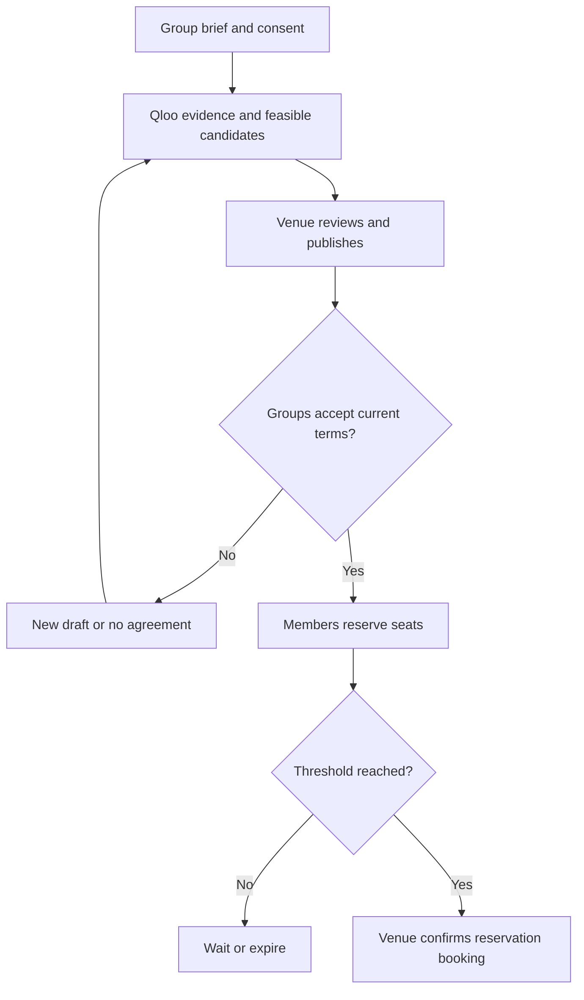
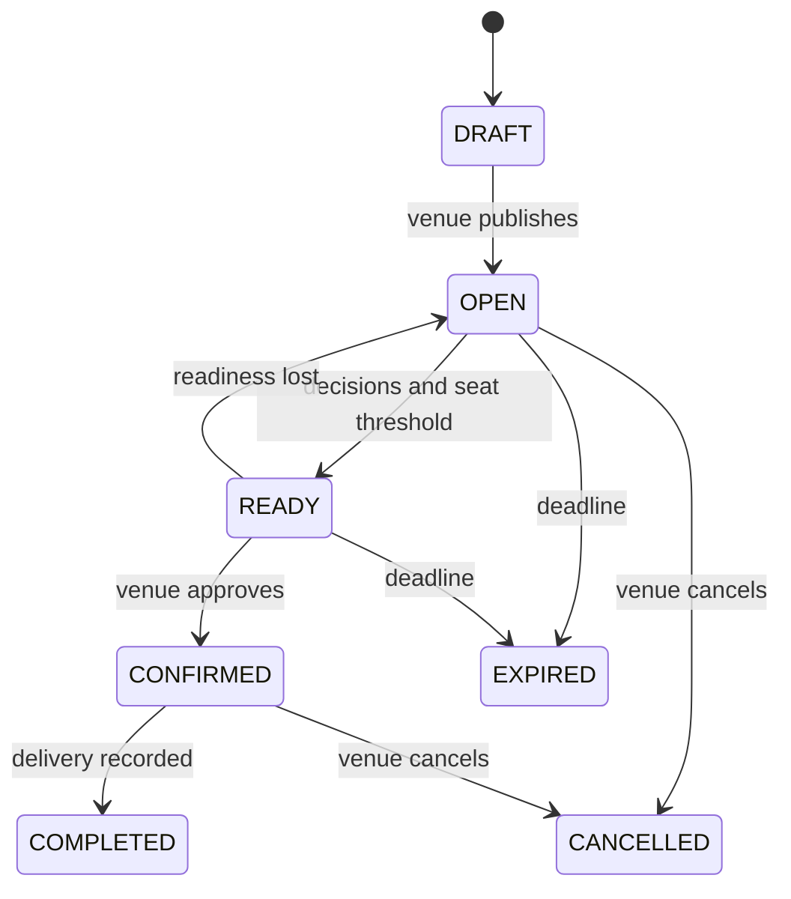

# User Journeys and Workflow Diagrams

D07 | Version 0.1 | 12 October 2026

Show end-to-end behaviour, decision branches and recovery paths.

Status: proposed implementation specification. Application acceptance tests remain pending.

## Primary journey

An organiser submits a group brief and reviews resolved references. The matching service checks eligible partner groups and venue offers. The venue reviews and publishes a proposal. Every included organiser responds to the same version. Members reserve individual seats. The venue confirms a ready reservation booking and later records delivery.

Main workflow with human decisions and reservation checks.

## Journey checkpoints

| Checkpoint | User sees | System checks | Recovery |
| --- | --- | --- | --- |
| Brief ready | References, meaning, budget, dates and sharing choice. | Consent and required structured fields. | Save draft; resolve missing information. |
| Proposal offered | Exact programme, price, date and evidence. | Feasibility and approved anchor mapping. | Show blockers or revise candidate. |
| Group decision | Current version and other group summaries approved for sharing. | Actor represents an included group. | Decline; explain reason; trigger a new draft. |
| Seat reservation | One seat, deadline and no payment collection. | Membership, version, deadline and remaining capacity. | Refresh terms, withdraw or wait for a later offer. |
| Venue confirmation | Reserved count and readiness checklist. | All decisions, economics, quote and slot in one transaction. | Return to OPEN if readiness was lost. |

## Proposal lifecycle

Readiness can be lost before confirmation; terminal states retain history.

## Rejection and revision journey

An organiser rejects a proposal because of time, cost, subject or sharing. The system records the reason without assuming a taste failure. A new run may change the experience, coalition or slot within declared constraints. Material changes create a new version; organisers and participants explicitly approve again.

## Failure journeys

- No feasible option: display the limiting constraint and which user can change it. Do not manufacture a proposal.
- Qloo unavailable: offer a labelled manual catalogue path and retain any existing reservation.
- Last-seat race: the unsuccessful participant receives a capacity error and no seat allocation.
- Cancelled experience: notify every affected actor in-app and make the venue's contact route visible.

## Diagram sources

Editable Mermaid sources and rendered diagrams are in diagrams/. The diagrams describe the proposed implementation and do not imply that integrations are already deployed.

## Related documents

D05, D14, D20
