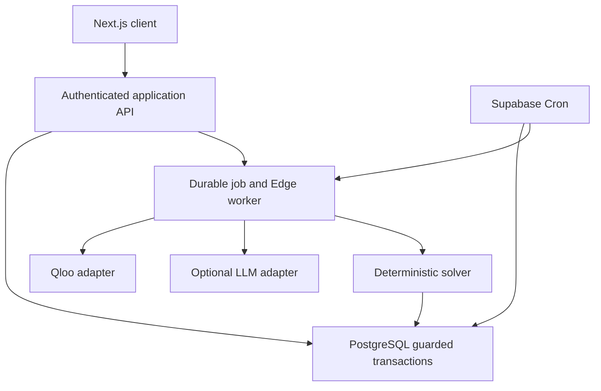

# System Architecture Document

D09 | Version 0.1 | 12 October 2026

Define component responsibilities and trust boundaries.

Status: proposed implementation specification. Application acceptance tests remain pending.

## Architecture

Provider calls and privileged operations remain behind authenticated server boundaries.

| Component | Responsibility | Boundary |
| --- | --- | --- |
| Next.js client | Forms, catalogue views, proposal comparison, status and role-scoped actions. | Untrusted inputs; no Qloo or service-role key. |
| Next.js API | Authenticate, authorise, validate DTOs, apply rate limits and request transactions. | Never trust IDs or roles supplied by the browser. |
| Domain services | Quote arithmetic, hard constraints, coalition scoring and lifecycle guards. | Deterministic code; independent of LLM output. |
| PostgreSQL | Immutable revisions, active reservations, membership checks, locks and audit records. | Fail-closed grants and RLS; critical writes through guarded functions. |
| Supabase Edge worker | Lease agent jobs, call Qloo and LLM, checkpoint bounded steps. | Server credentials; role-limited tool allowlist. |
| Supabase Cron | Expire proposals and recover abandoned leases. | Scheduled database maintenance; no browser dependency. |
| Qloo adapter | Entity lookup and rank evidence. | External service; no identity or access notes. |
| LLM adapter | Structured brief extraction and evidence-grounded draft wording. | Optional; cannot price, confirm or change permissions. |

## Chosen architecture and tradeoffs

Use one modular application and database. Durable asynchronous jobs isolate provider latency from booking transactions. A bounded worker handles initial execution; the database scheduler handles recovery and expiry. Vercel is not the durable queue.

## Data flow

The worker sends consented cultural IDs to Qloo. Approved mappings connect returned entities to experiences. The solver writes sanitised DRAFT proposals; human publication and reservations use guarded database transactions.

## Isolation

Each workspace contains one pilot exchange. Organisers and authorised operators can read private briefs; participants receive approved group summaries. Signed judge capabilities address isolated synthetic workspaces only.

## Availability and failure

Qloo outages stop new cultural matching, while published terms remain usable. LLM failure permits deterministic explanations. Database outages block mutations and report retryable failure; never report a false success.

## Related documents

D10, D15, D19, D23

## Sources

- SRC10: Supabase Row Level Security. https://supabase.com/docs/guides/database/postgres/row-level-security
- SRC11: Supabase Cron. https://supabase.com/docs/guides/cron
- SRC12: Vercel Cron usage and pricing. https://vercel.com/docs/cron-jobs/usage-and-pricing
